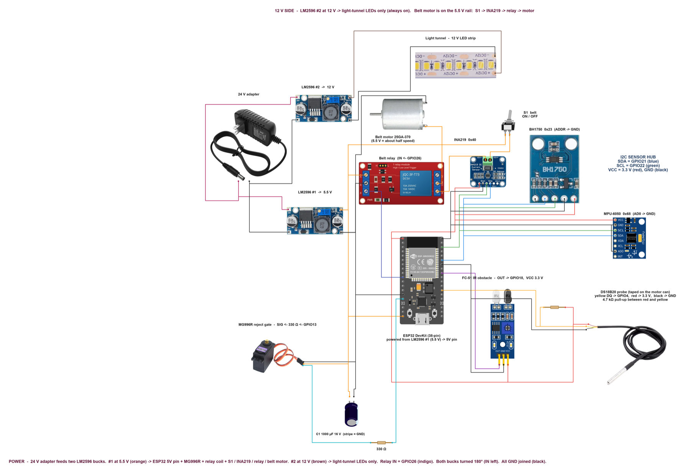
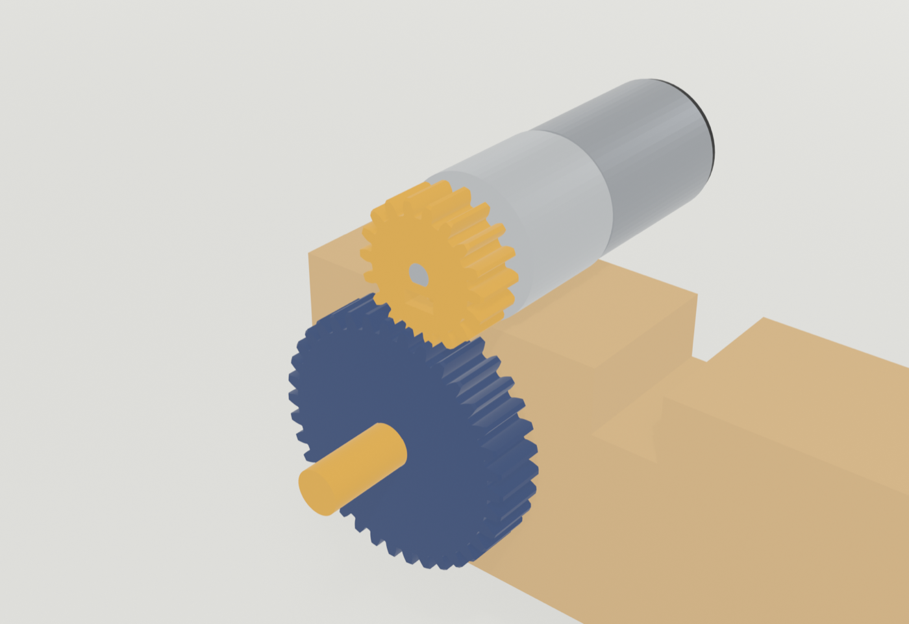
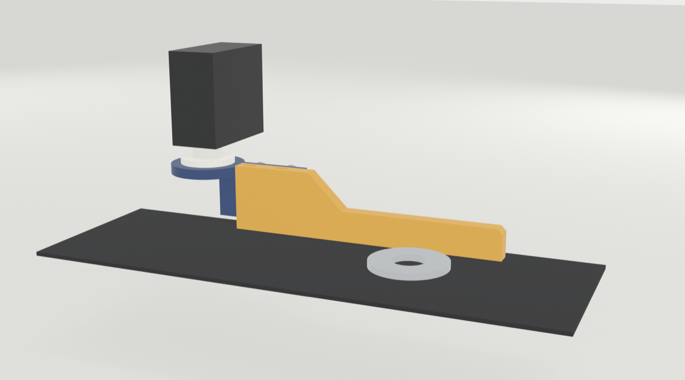

# Hardware & Bring-up Guide

> The NAZAR rig: power, wiring, sensors, conveyor and gate — and the order to switch it on and test it today.

## What the rig is

A short wooden conveyor carries steel washers through a **light tunnel**. A camera looks straight down into the tunnel. When a washer passes the **IR sensor**, the ESP32 lets the belt run a few more centimetres, then **stops it with a relay** so the washer sits still under the camera. The Mac takes the photo, the AI decides PASS / HOLD / REJECT, and the belt restarts. A rejected washer is **kicked off the belt by a servo arm** further down.

While this happens the ESP32 measures the machine itself: **motor current and voltage** (INA219), **vibration** (MPU-6050), **tunnel light** (BH1750) and **motor temperature** (DS18B20). Those readings are what let NAZAR explain *why* defects happen, not only *that* they happen.



## Parts list

| Part | Job on the rig | Talks to the ESP32 by |
|---|---|---|
| ESP32 DevKitC 38-pin (WROOM, CP2102 USB) | Brain of the line: reads sensors, runs the belt, fires the gate, streams data to the Mac | USB serial 115200 |
| 24 V DC adapter | Main power in | — |
| LM2596 buck #1, set to **5.5 V** | Main rail: ESP32 5V pin, MG996R servo, relay coil, belt motor | — |
| LM2596 buck #2, set to **12 V** | LED rail: light-tunnel LED strip only | — |
| 1000 µF 16 V capacitor (C1) | Absorbs the servo's current kick on the 5.5 V rail | — |
| 25GA-370 12 V gear motor (run at 5.5 V) | Drives the belt through 18T/36T printed gears | via relay |
| 1-channel 5 V relay module | Starts / stops the belt (stop-and-inspect) | GPIO26, active LOW |
| Toggle switch S1 | Master belt switch (the real "off") | — |
| INA219 current sensor | Belt-motor current (mA) and voltage (V) | I²C 0x40 |
| MPU-6050 accelerometer | Motor / frame vibration | I²C 0x68 |
| BH1750 light sensor | Light level inside the tunnel | I²C 0x23 |
| DS18B20 waterproof probe | Motor-can temperature | 1-Wire, GPIO4 |
| FC-51 IR obstacle sensor | Detects each washer arriving | GPIO18 |
| MG996R servo + printed arm | Kicks rejected washers off the belt | PWM, GPIO13 |
| 12 V white LED strip | Even light in the tunnel, always on | — |
| Resistors: 4.7 kΩ, 330 Ω | DS18B20 pull-up; servo signal series resistor | — |
| Camera (Logitech C270 / phone via Iriun) | Top-down photo of each washer | USB to the Mac |

## Power — two rails from one adapter

```
24 V adapter ─┬─▶ LM2596 #1 ── 5.5 V ──┬─▶ ESP32 "5V" pin
              │                        ├─▶ MG996R red wire
              │                        ├─▶ relay module VCC
              │                        ├─▶ C1 1000 µF (stripe to GND)
              │                        └─▶ S1 ─▶ INA219 VIN+ ─▶ VIN−
              │                                   ─▶ relay NO ─▶ COM ─▶ motor (+)
              │                                      motor (−) ─▶ GND
              │
              └─▶ LM2596 #2 ── 12 V ────▶ LED strip (+)   tunnel light, always on

All grounds joined: buck #1 OUT−, buck #2 OUT−, ESP32 GND,
sensor GNDs, servo brown wire, relay GND.
```

**Why two bucks?** The 12 V LED strip needs 12 V; everything else runs on 5.5 V. The belt motor is a 12 V motor, but it runs on the 5.5 V rail at about half speed (roughly 60 rpm instead of 130) — slow is fine, even good, for stop-and-inspect. Buck #1 now carries the ESP32, servo, relay and motor, so give it a heatsink and short thick wires.

**Why 5.5 V and not 5.0 V?** The MG996R is stronger above 5 V (rated 4.8–7.2 V), and the ESP32's own regulator takes 5.5 V easily. Do not go above 6 V on rail #1.

**Why the INA219 sits before the relay:** it measures the current the motor actually draws. A jammed belt shows as high current; a slipping or stopped belt shows as low current.

### Setting the bucks — do this before connecting anything

1. Connect only the 24 V adapter to a buck's IN+/IN−. Nothing on OUT.
2. Put a multimeter on OUT+/OUT−. Turn the brass trimmer screw (many turns; clockwise usually lowers the voltage) until it reads **5.5 V** on #1, **12.0 V** on #2.
3. Mark each buck with tape: "5.5 V" and "12 V". Swapping them would kill the ESP32.

## ESP32 pin map

| Signal | ESP32 GPIO | Wire colour (diagram) | Notes |
|---|---|---|---|
| I²C SDA | 21 | blue | shared by INA219, MPU-6050, BH1750 |
| I²C SCL | 22 | green | shared |
| Sensor power | 3V3 | red | all four sensors run on 3.3 V |
| FC-51 OUT | 18 | purple | LOW when a washer is in front |
| DS18B20 DQ (yellow) | 4 | yellow | 4.7 kΩ between yellow and red |
| MG996R signal (orange) | 13 | cyan | through 330 Ω |
| Relay IN | 26 | indigo | LOW = belt runs; released = belt stops. Jumper on **L** |
| Power in | 5V | orange | from buck #1 (5.5 V) |
| GND | GND | black | common ground |

I²C addresses: INA219 **0x40**, MPU-6050 **0x68** (AD0 to GND), BH1750 **0x23** (ADDR to GND). No two are the same, so they can share the two wires.

## How each sensor works (the short version)

**INA219 — current and voltage.** A tiny 0.1 Ω shunt resistor sits in the motor's + wire. Current through it makes a small voltage drop; the INA219 measures that drop with a 12-bit converter and reports current. It also measures the bus voltage. On this rig: idle belt about 100–300 mA; a jam pushes it towards 700 mA+.

**MPU-6050 — vibration.** A MEMS accelerometer: a microscopic mass on springs inside the chip; acceleration moves it, which changes a capacitance. The firmware reads it 200 times a second, takes the size of the acceleration vector |a|, subtracts its slow average (gravity and tilt), and reports the RMS and peak of what is left — that is the shaking. The team's board is mounted tilted about 77°; using |a| makes that irrelevant. Quiet motor: about 0.002–0.02 g. A loose motor mount: 0.08 g and up.

**BH1750 — light.** A photodiode with a filter shaped like the human eye's response, plus an ADC that gives lux directly. If the tunnel light drops, the camera picture changes and the AI gets less reliable, so NAZAR warns before that happens.

**DS18B20 — temperature.** A digital thermometer on a single data wire ("1-Wire"). The 4.7 kΩ pull-up keeps that wire HIGH when nobody is talking. A conversion takes 750 ms, so the firmware starts one, does other work, and collects the result later — the 10 Hz data stream never pauses.

**FC-51 — part detector.** An IR LED shines out; if something reflects it back into the photodiode, a comparator pulls OUT LOW. The blue trimmer sets the distance. Set it so a washer on the belt triggers it and the empty belt does not.

**MG996R — reject gate.** A servo turns to an angle set by pulse width (about 0.5–2.5 ms, every 20 ms). The ESP32 makes that signal with its LEDC PWM hardware. The 330 Ω resistor protects the GPIO if the servo misbehaves.

**Relay — belt start/stop.** The module's input is *active LOW*: the ESP32 pulls IN to GND to switch the relay on. To switch it off, the ESP32 *releases* the pin (makes it an input) so the module's own pull-up takes IN to 5 V. Driving 3.3 V HIGH would not reliably turn a 5 V module off — releasing the pin does.

## Wiring and bring-up order

Wire one block, test it with its bring-up sketch from **nazar-firmware/bringup/**, then move on. If a test fails, you know it is the last block you touched.

| Step | Wire this | Flash and check | It passes when |
|---|---|---|---|
| 0 | Nothing. ESP32 on laptop USB only | Any sketch uploads | Upload finishes; port is `/dev/cu.usbserial-…` |
| 1 | INA219, MPU-6050, BH1750 on 3V3/GND/21/22 | `01_i2c_scan` | Finds 0x23, 0x40, 0x68 — exactly these three |
| 2 | — | `02_ina219`, `03_mpu6050`, `04_bh1750` | Current ≈ 0 with motor off; vibration rises when you tap the board; lux drops when you cover the sensor |
| 3 | DS18B20 + 4.7 kΩ on GPIO4 | `05_ds18b20` | Room temperature; rises when you hold the tip |
| 4 | FC-51 on 3V3/GND/18 | `06_fc51_ir` | Prints PART when a washer passes, CLEAR otherwise; adjust trimmer |
| 5 | Set bucks (above). Wire buck #1 → ESP32 5V, C1, servo, relay VCC | `07_servo_gate` | Arm moves between parked and kick angles; ESP32 does not reset during the move |
| 6 | Buck #2 → LEDs; buck #1 → S1 → INA219 → relay → motor | `08_relay_belt` | `1` runs the belt, `0` stops it; S1 off always stops it |
| 7 | Everything | `nazar_line` (main firmware) + `tools/serial_check.py` | `hello` lists all four sensors true; telemetry 10 lines/s; PING → pong |
| 8 | Camera + Mac app | NAZAR Console | LIVE DATA band; a washer stops under the camera; verdict comes back; REJECT kicks it off |

Before step 5: unplug USB, power up from the 24 V side once and measure 5.5 V at the ESP32 5V pin. Most DevKitC boards have a diode so USB and the 5V pin can be connected together; if you are not sure, run from one source at a time.

## Conveyor mechanics

- **Frame:** two wooden rails 640 × 80 × 18 mm, 135 mm apart inside, on leg blocks.
- **Rollers:** 25 mm PVC pipe, 125 mm long, with 3D-printed end plugs on 608ZZ bearings; 540 mm centre to centre.
- **Drive:** the 25GA-370 (12 V, 130 rpm; about 60 rpm on our 5.5 V rail) lies on top of the rail in the printed **P7S saddle** and drives the roller through printed **18T / 36T gears** (2:1, 33 mm centre distance). Slide the motor along the rail to set the mesh. Gears reverse direction compared with a belt — swap the motor wires if the belt runs backwards.
- **Light tunnel:** printed brackets hold the 12 V LED strip; the camera looks down through the top. Keep camera height and lighting **the same as when the AI was trained**.
- **Reject gate:** MG996R on the printed **P13 tower**, with the **P14 sort arm** (15 mm height adjustment). It is a *kick*, not a slow diverter: parked along the rail, it swings about 70°, holds ~0.35 s and returns. Washers need about 100 mm spacing.





Printable files for these parts are in `mechanical/stl/`.

## Camera setup for good AI results

1. Camera straight down, fixed height, washer filling about a third of the frame.
2. Tunnel LEDs on. In NAZAR Console open **Camera → Settings**: switch off automatic exposure, lower exposure until the "too bright" meter reads near 0 % with a washer in view (on the C270 about 1.5 ms, gain 0), set power-line frequency to **50 Hz**.
3. Use the console's capture mode to photograph 40–50 good washers in different positions, then retrain (see the Vision AI guide).

## Troubleshooting

| Symptom | Likely cause | Fix |
|---|---|---|
| I²C scan finds nothing | SDA/SCL swapped, or no 3V3 | Blue = 21, green = 22; measure 3.3 V at each sensor |
| MPU answers 0x70/0x72/0x98 instead of 0x68 | Clone chip | Fine — firmware accepts it |
| DS18B20 reads −127 °C or 85 °C | Missing pull-up / read too early | 4.7 kΩ between yellow and red |
| ESP32 resets when the servo moves | 5.5 V rail sags | C1 fitted, short thick wires, buck #1 not overloaded |
| ESP32 resets when the belt starts | motor start current sags the 5.5 V rail (the motor shares it now) | same fixes, plus 470–1000 µF right at the ESP32 5V/GND pins |
| Belt never stops | Relay jumper on H, or IN wired to wrong pin | Jumper on L, IN to GPIO26 |
| Belt never runs | S1 off, or relay NO/COM swapped | Motor + goes through COM → NO |
| Current reads negative | INA219 VIN+ and VIN− swapped | VIN+ from S1 side, VIN− to relay |
| Upload fails "port busy" | Console app or serial monitor holds the port | Disconnect in NAZAR Console first |
| AI gives HOLD on good washers | Photo too bright or light changed | Lower exposure, recapture, retrain |

## Safety

- S1 is the master belt switch. Keep fingers clear of the gears when S1 is on — the relay can restart the belt at any moment.
- The bucks get hot under load; buck #1 needs its heatsink.
- Never connect the 24 V adapter directly to anything except the buck inputs.

## Status today (2 Nov, onsite)

- **Designed and drawn:** full wiring (Cirkit Designer files in `cirkit/`, renders and PDF in `diagrams/`), mechanical parts printed.
- **Tested on a real board earlier (1 Nov):** ESP32 enumerates; MPU-6050 genuine at 0x68.
- **Not yet tested on the real rig:** the other sensors, relay, servo kick timing, full stop-and-inspect cycle. That is today's bring-up, in the order above.
